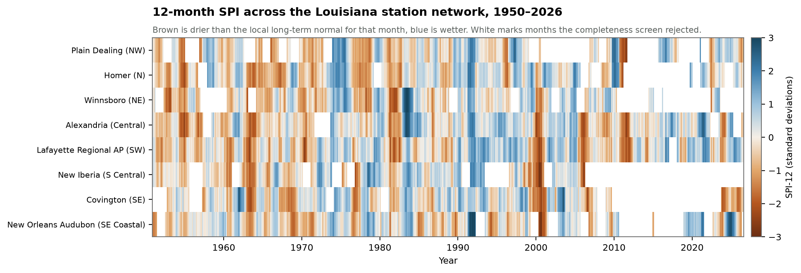

# Drought Index Analysis — Louisiana Station Network

SAS · Python (pandas, SciPy, Matplotlib) · NOAA GHCN-Daily

Standardised Precipitation Index for eight long-record Louisiana weather stations,
1950–2026, with drought frequency, duration and severity compared across seasons and
locations.



Each row is a station, ordered north to south. Brown is drier than that station's own
long-term normal for that calendar month. The vertical brown bands are regional droughts
showing up simultaneously at stations hundreds of kilometres apart — 1963–64, 1999–2000,
2010–11 and 2022–23 are all visible.

---

## Findings

Built from **206,693 quality-screened daily observations**, reduced to 6,701 station-months
(97.8% of candidate months passed the completeness screen) and 5,638 SPI-12 values.

| | |
| --- | --- |
| Drought episodes (SPI-12 ≤ −1) | **216** across the network |
| Mean episode duration | 4.3 months |
| Longest episode | **23 months** — Covington, from July 1999 |
| Most severe episode | Covington 1999–2001, accumulated deficit 39.3 SPI-months, peak SPI −3.04 |
| Share of months in drought | 15.4% – 18.3% by station |

**The 1999–2000 drought reached 7 of the 8 stations**, making it the most widespread
episode in the record. Lafayette had the highest drought incidence (18.3% of months) and
the most episodes (42); Alexandria and New Iberia the lowest at 15.4%.

**Drought incidence is remarkably even across seasons** — 16.1% in spring to 17.1% in
autumn. Louisiana's droughts are not a summer phenomenon; they are a failure of
accumulated moisture that can begin in any season. Severe episodes (SPI ≤ −1.5) are
slightly more common in winter (5.8%) than summer (4.0%).

### Method check

Observed drought frequency of 15.4–18.3% sits against a theoretical **15.87%** — the
probability of falling at or below one standard deviation on a standard normal. That
agreement is evidence the gamma fits are behaving, not an assumption. `fig5_distribution.png`
shows the fitted SPI-12 distribution against the normal it should reproduce.

---

## Repository

```
├── fetch_ghcn.py          downloads GHCN-Daily .dly files, QA screens, aggregates monthly
├── compute_spi.py         SPI at 3/6/12 months, drought events, summaries
├── make_figures.py        five figures
├── drought_analysis.sas   independent SAS recomputation and cross-check
├── data/                  monthly grid, SPI, events, summaries, QA report
└── figures/
```

## Reproducing

```bash
pip install pandas numpy scipy matplotlib
python fetch_ghcn.py      # ~110 MB of raw .dly, cached in data/raw
python compute_spi.py
python make_figures.py
```

Then open `drought_analysis.sas`, set `%let proj =` to the folder, and run.

## Method

**Data.** NOAA GHCN-Daily, eight stations selected for record length and geographic
spread across Louisiana's climate regions, from 43 candidates with 64+ years of
precipitation through the present. Records begin 1950 for a common period; several
stations extend back to the 1890s.

**Quality control.** Observations carrying a NOAA quality flag are discarded rather than
treated as zero. A month is used only if at least 90% of its days survive; 154 of 6,855
station-months were rejected on that basis. Months that fail the screen are left as gaps
rather than interpolated, and **any accumulation window containing a gap is itself
discarded** — which is why the heatmap has white cells and why SPI-12 is available for
5,638 of 6,701 months.

**SPI.** Follows McKee et al. (1993). For each station, timescale and calendar month
separately, a two-parameter gamma distribution is fitted by maximum likelihood to the
non-zero accumulations. Zero-precipitation accumulations are handled with a mixed
distribution, H(x) = q + (1−q)·G(x), where q is the empirical probability of zero. The
resulting cumulative probability is mapped to the standard normal, so SPI is in standard
deviations: −1 is roughly the 16th percentile of that station's record for that month,
−2 the 2nd.

**Drought events** are runs of consecutive months at or below SPI −1. Duration is the run
length; severity is the accumulated deficit (the sum of |SPI| over the run), so a long
mild drought and a short intense one can be compared on one scale.

**The SAS program recomputes SPI-12 independently** from the same monthly grid — its own
gamma fits via `PROC UNIVARIATE`, its own `CDF('GAMMA', …)` and `PROBIT()` — then reports
the difference against the Python result and correlates the two. It is a cross-check, not
a restatement, and it produces the station and seasonal summaries with `PROC MEANS`,
`PROC FREQ` and `PROC SGPLOT`.

## Limitations

- **SPI is a precipitation index only.** It says nothing about temperature, evaporative
  demand or soil moisture. A warm drought and a cool one of equal rainfall deficit score
  the same. SPEI would be the index to use if potential evapotranspiration matters.
- **Station coverage thins after about 2005.** New Iberia's usable SPI-12 record ends in
  2006 and Winnsboro's in 2023, as COOP observing practice changed. Recent decades rest on
  fewer stations than the mid-record, so treat the right-hand edge of the heatmap with more
  caution than the middle.
- **Eight stations is a sparse network** for a state of this size. These are point records,
  not a gridded surface, and say nothing directly about conditions between them.
- **The gamma fit needs a reasonable sample.** Station-months with fewer than 30
  observations or 20 non-zero accumulations are skipped rather than fitted.
- **SPI-12 responds slowly.** It is suited to hydrological drought — reservoirs, shallow
  groundwater — and will miss a sharp agricultural drought that SPI-3 would catch. All
  three timescales are computed for that reason.
- Drought episodes are defined by a fixed −1 threshold. It is conventional, not physical,
  and a different threshold would give different counts.

## Data source

NOAA National Centers for Environmental Information, Global Historical Climatology
Network-Daily, Version 3. <https://www.ncei.noaa.gov/products/land-based-station/global-historical-climatology-network-daily>

Menne, M.J. et al. (2012). An overview of the Global Historical Climatology Network-Daily
Database. *Journal of Atmospheric and Oceanic Technology*, 29, 897–910.

McKee, T.B., Doesken, N.J., Kleist, J. (1993). The relationship of drought frequency and
duration to time scales. *Eighth Conference on Applied Climatology*, 179–184.

## License

[MIT](LICENSE) for the code. Figures may be reused with attribution.
